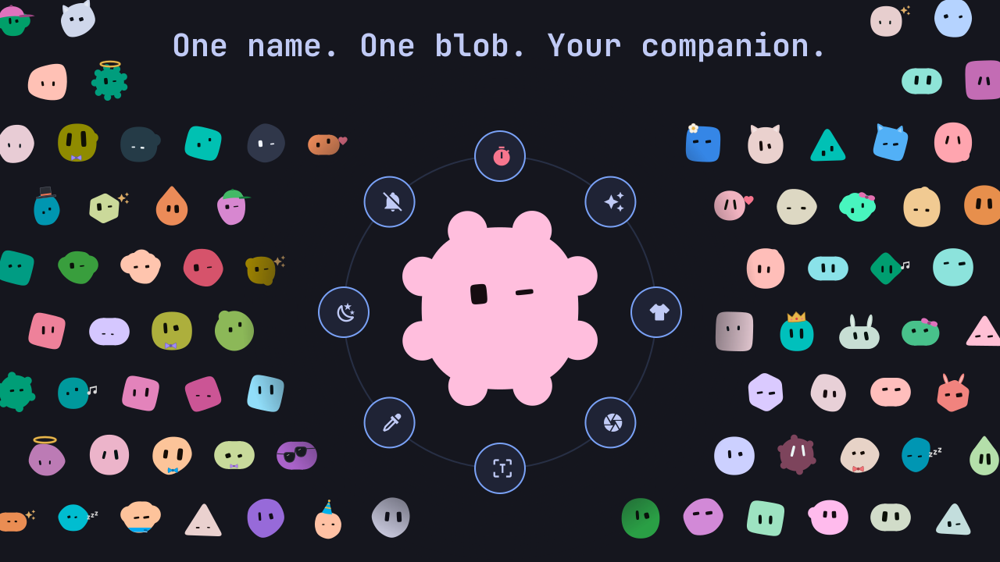
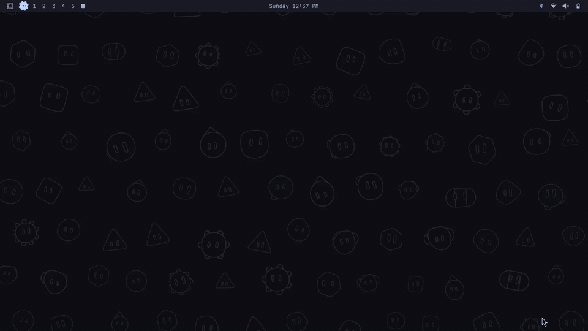
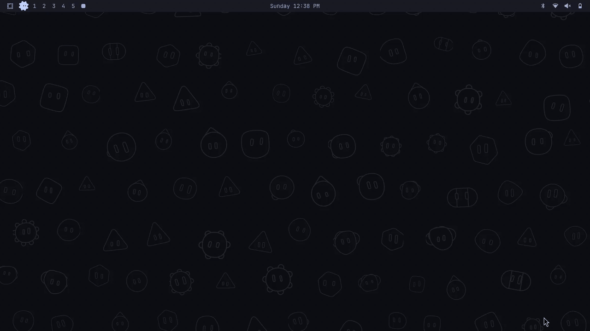
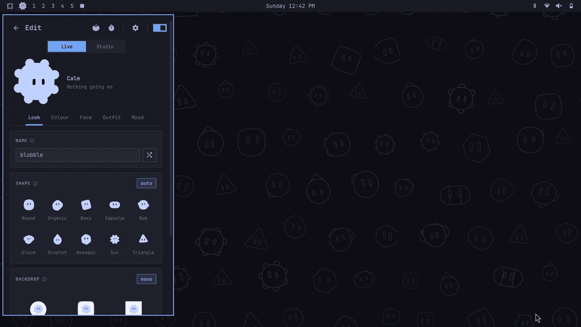
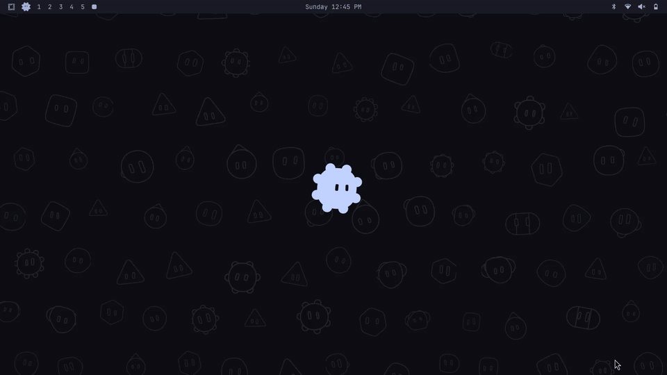
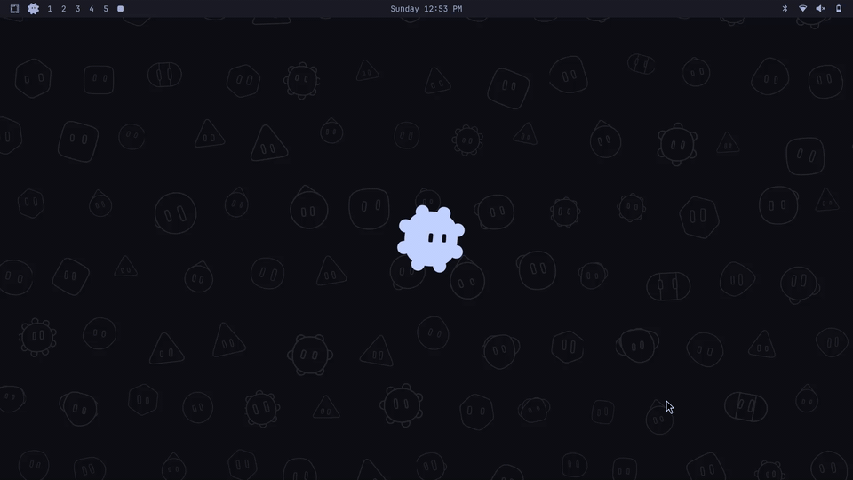
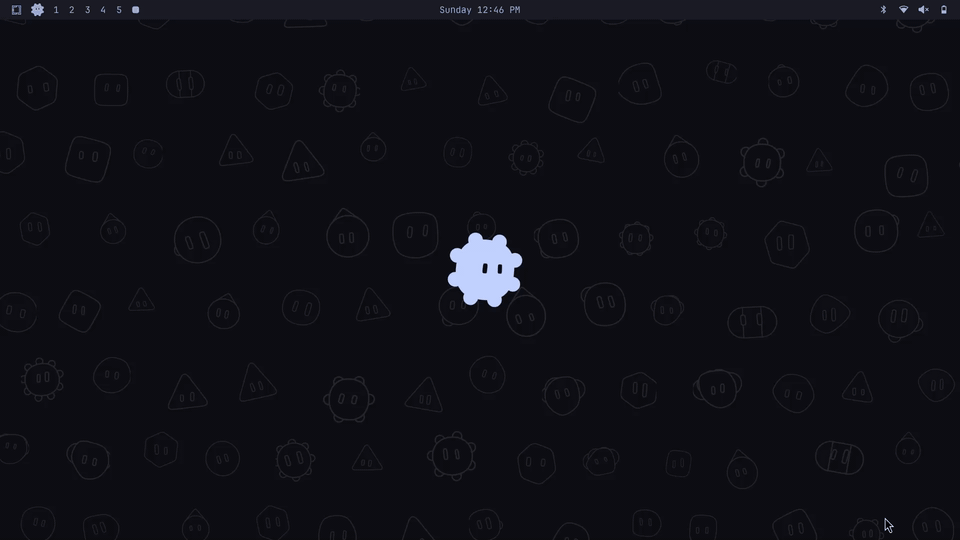
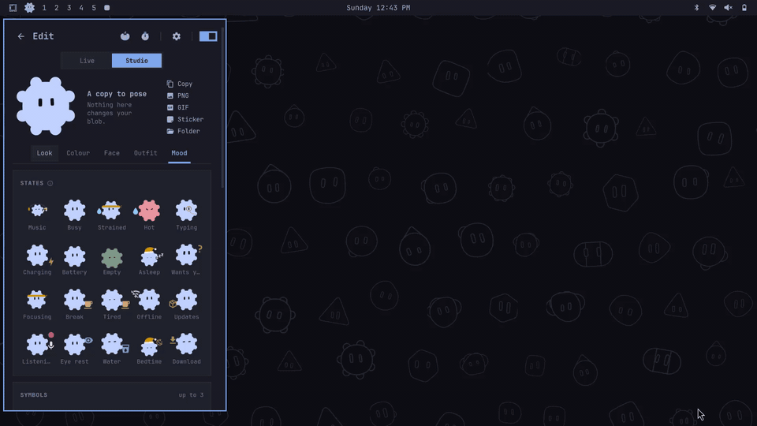

<div align="center">

# Blobble

**A cozy little companion made from your name.**

A small creature that lives in your tray or your bar, or walks around your
desktop. It reacts to what you do, keeps you on a Pomodoro and dresses up for
the occasion.



The cross-platform sibling of [OmaBlob](https://github.com/M44F4/omablob), by the same author.

</div>

## Install

| Platform | Status | How |
|---|---|---|
| Windows 10 and 11 | **Ready** | [Download the installer](#windows) |
| Omarchy | **Ready** | A bar widget, like OmaBlob's: [build it](#omarchy) |
| Hyprland, Sway and niri setups like Omarchy | **Should work** | The app and pet run; some reactions and cursor tracking are Hyprland only, see [other Linux](#other-linux) |
| GNOME, KDE and X11 | **Experimental** | A tray icon and the panel; the desktop pet is limited, see [other Linux](#other-linux) |
| macOS | Not yet | [Help wanted](#contributing) |

### Windows

Download `Blobble_x64-setup.exe` from the [latest release](https://github.com/M44F4/blobble/releases/latest)
and run it. It asks once whether to start with Windows, then your blob appears
in the tray, by the clock. Click it to meet your blob.

The app is not signed yet, so Windows may say it protected your PC: click
**More info**, then **Run anyway**.

### Omarchy

On Omarchy, Blobble is a bar widget, the way OmaBlob is: the shell places it,
you move it with the rest of your bar, and it follows the bar to any side. The
widget starts the app, and the app goes away if you take the widget out.

1. Download `Blobble_*_amd64.AppImage` from the
   [latest release](https://github.com/M44F4/blobble/releases/latest) and put it on your
   `PATH` as `blobble`:

   ```bash
   install -Dm755 Blobble_*_amd64.AppImage ~/.local/bin/blobble
   ```

2. Run `blobble` once. It puts its bar widget in `~/.config/omarchy/plugins` by
   itself, and keeps it up to date when you update the app.
3. Add **Blobble** to your bar like any widget (it is in the plugin list) and
   click it to meet your blob.

Prefer to build it? `npm install && npm run build:linux` in `desktop/` makes the
same packages. [desktop/omarchy/README.md](desktop/omarchy/README.md) explains
how the widget and the app talk.

Already use OmaBlob? Your blob code works in Blobble, and the two can live side
by side.

### Other Linux

Blobble is a Tauri app, so it runs on any Linux with WebKitGTK. Beyond Omarchy,
how much works depends on your desktop:

| | Omarchy | Other Hyprland | Sway, niri | GNOME, KDE, X11 |
|---|---|---|---|---|
| Tray icon, panel, settings, Studio, Pomodoro | ✓ | ✓ | ✓ | ✓ |
| Desktop pet as a layer | ✓ | ✓ | untested | not yet |
| Eyes and dragging follow the cursor | ✓ | ✓ | not yet | not yet |
| Workspace, window and notification reactions | ✓ | partly | not yet | not yet |
| Bar widget | ✓ | not yet | not yet | not yet |

Only Omarchy has been tested by the author. If you run one of the others and
something is off, an issue helps; a pull request helps more. See
[Contributing](#contributing).



## At home in your bar or on your taskbar

**On Omarchy** it sits in the bar, watches your cursor and now and then walks
over to visit another widget: the clock on the hour, the media player when
music starts. Pick its size in Settings, from a tiny icon to a big blob that
hangs below the bar. Off, or while the pet is out, it keeps still in its slot.



**On Windows** your blob lives in the tray, by the clock. It blinks, watches your cursor and
changes face with its mood. Let it out and it sits on the taskbar, right next
to the tray, wherever your taskbar is: bottom, top, left or right. While it
sits there, the tray blob keeps still, so only one blob moves on screen.

Windows does not let apps put widgets inside the taskbar, so Blobble uses the
tray and the taskbar's edge instead of a bar widget.

## One name, one blob

Your blob is made from a piece of text (your username by default). The same
text always gives the same blob, so nobody else has yours. Type a new name and
a new creature appears.

Then make it yours: 10 shapes, 14 faces, any colour, a backdrop, and outfits
that fit every shape. Share your blob with a short code like
`blobble:n=pebble;s=sun;f=happy;wh=crown`. Codes from OmaBlob work too.



## It feels what you do

Music makes it groove. A busy CPU makes it think, then sweat. It dozes off when
you step away and wakes up surprised when you come back. When several things
happen at once it shows them all together: music while the CPU is strained
means bobbing along with a sweat drop.



<details>
<summary><b>Everything it reacts to</b> (each one has its own switch)</summary>

| Reaction | What it does | Windows | Omarchy |
|---|---|---|---|
| Music | Grooves while something plays, with little notes | ✓ | ✓ |
| Workload | Thinks when the CPU is busy, sweats and shakes when strained, turns red when hot | ✓ | ✓ |
| Sleep | Dozes off when you are away, wakes up surprised when you come back | ✓ | ✓ |
| Battery | Happy while charging, tired when low, pale when nearly empty | ✓ | ✓ |
| Eyes follow cursor | Watches your mouse, anywhere on screen | ✓ | ✓ |
| Pokes | Click it to poke it. Poke it too much and it gets mad | ✓ | ✓ |
| Network | Looks unsure while you are offline | ✓ | ✓ |
| Disk space | Worries when the disk is almost full | ✓ | ✓ |
| Downloads | Cheers when a download lands. Click the pet right after for what it can do with the file | ✓ | ✓ |
| Theme | A spin and a sparkle when you change the theme or accent colour | ✓ | ✓ |
| Typing | Off by default. Glances at your keyboard while you type. No keys are read | ✓ | ✓ |
| Break reminder | Off by default. Gets sleepy and holds a coffee after a long stretch | ✓ | ✓ |
| Rest your eyes | Off by default. Every 20 minutes it looks far away for 20 seconds, so you do too | ✓ | ✓ |
| Water | Off by default. Holds up a glass of water now and then | ✓ | ✓ |
| Bedtime | Off by default. Gets sleepy and puts its nightcap on from the time you pick | ✓ | ✓ |
| Notifications | Jumps when one pops up. Quiet during Do Not Disturb | not yet | ✓ |
| Workspaces | Hops and leans the way you switch | not yet | ✓ |
| Windows | A little hop and a glance at a window that opens, a wink at one that closes | not yet | ✓ |
| Wants you | Looks up with a question when a window asks for attention | not yet | ✓ |
| Long commands | Cheers when a terminal command of 30 seconds or more succeeds, sulks when it fails | not yet | ✓ |
| Updates | Holds a little parcel when Omarchy updates are ready | not yet | ✓ |
| Power mode | Shows performance and power saver modes | not yet | ✓ |
| Mic and camera | A red dot while the microphone, a camera or a screen recording is on | not yet | ✓ |

Moments can dress it up too, each with its own switch: a nightcap asleep,
headphones with music, glasses in a code editor, a sweatband when strained,
seasonal hats. Or keep your own outfit no matter what.

</details>

## A pet on your desktop

Drag it off the taskbar and it walks around near its spot, follows your cursor
with its eyes and naps when you leave. Drag it anywhere: it gasps, leans into
the drag and lands with a bounce. Drop it back on the taskbar and it goes home.
When a video or game goes fullscreen it ducks out of the way.

Right click it (or hold it) and its actions fan out in a ring: a trick, the
Studio, its outfit, the Pomodoro, a screenshot, the colour picker, night light,
Task Manager and more. The ring never covers the taskbar, and you pick what
goes in it. Prefer a plain list? That is one switch away.



Drop files on it to copy an image, turn pictures into PNG or JPG, shrink them,
zip files or copy their paths. Results go next to the originals. With
[ffmpeg](https://ffmpeg.org) installed, it turns a video into a GIF too.

## Focus with it

A real Pomodoro: 25 minutes of focus, a 5 minute break, a longer one every 4
rounds, all adjustable, with pause, skip and stop. Your blob wears its
headband while you work and grabs a coffee on breaks. The countdown sits in a
little pill next to the pet. There is a plain timer too.



## Stickers, pictures and GIFs

The Studio is a sandbox copy of your blob. Pose it with any face, outfit,
mood, symbols and motion, then copy it, or save a PNG, an animated GIF or a
512 px sticker. Drag the result straight into a chat, or paste it: it is on
the clipboard as a file. Pictures are saved in `Pictures\Blobble`. Nothing you
do in the Studio touches your real blob.



## How to use it

| Do this | To get |
|---|---|
| Click the tray blob (Windows) or the bar blob (Omarchy) | Its panel: mood, why it feels that way, your day, all settings |
| Right click the tray blob | Open, show or hide the pet, its ring, settings, start with Windows, quit |
| Right click the bar blob | Poke it |
| Middle click the bar blob | btop |
| Click the pet | Poke it |
| Right click or hold the pet | Its ring of actions |
| Drag the pet | Move it anywhere. On Windows, drop it on the taskbar to send it home |
| Drop files on the pet | Things it can do with them |

- **Ring:** arrows move, Enter picks, 1 to 9 pick directly, Esc closes.
- **Panel:** Ctrl+Tab changes the page, Esc closes.

A short welcome guide opens the first time. Settings > About shows it again,
checks for updates and links to support.

<details>
<summary><b>On Omarchy: keyboard shortcuts, commands and long commands</b></summary>

Switch on **Shortcuts** in Settings > Features (off by default). It adds a key
that opens the pet's ring (`SUPER + ALT + B` unless you change it), and one for
the panel if you set it. The keys are added to Hyprland while Blobble runs, and
your config files are not changed.

```bash
blobble --bar open settings    # a page by name: blob, pet, settings, appearance, studio, pomodoro, timer
blobble --bar ring             # the pet's ring (the panel when there is no pet)
blobble --bar toggle           # open or close the panel
blobble --bar poke
blobble --bar simulate music,strained   # try moods out; asleep, charging, offline too
blobble --bar simulate                  # clear them
```

To make the blob cheer or sulk when a long command finishes, switch on **Long
commands** in Settings > Features and add this line to `~/.bashrc`:

```bash
source ~/.config/omarchy/plugins/m44f4.blobble/bin/blobble.bash
```

It uses bash's own history timestamps, so it adds nothing to each command. Set
`BLOBBLE_MIN_SECONDS` to change the 30 second threshold.

</details>

## Privacy

Everything stays on your machine. No keys are read, no window contents are
looked at, and nothing is sent anywhere.

<details>
<summary><b>What it reads, and how often</b> (Windows)</summary>

Blobble reads how long you have been away and the battery state twice a
second, and CPU and memory use every second. It reads the title and artist of
what is playing from the media controls Windows shows on the volume flyout,
and the cursor position while eye tracking is on.

With their reactions on, it also checks for an internet connection every 5
seconds and the system drive's free space every minute, looks at the front
window's program name and title to tell a code editor apart, asks Windows
whether a fullscreen app is running, watches file names in your Downloads
folder and reads Windows' accent colour.

An idle blob only blinks. It animates only while there is something to show,
like music or a busy CPU.

</details>

<details>
<summary><b>What it reads, and how often</b> (Omarchy)</summary>

Blobble reads `/proc/stat`, `/proc/meminfo`, the battery and the CPU
temperature in `/sys`, and how long you have been away (from Wayland's idle
notification), a few times a second. It asks Hyprland where the cursor is
while eye tracking is on and listens to Hyprland's events (workspace changes,
windows opening, closing or asking for you, screen recording). It watches
Omarchy's notification folder for new toasts (only their urgency is used),
checks for a default route every few seconds, runs `df` on `/` and
`powerprofilesctl` now and then, and runs `omarchy-update-available` every
6 hours.

The mic and camera reaction only sees that a PipeWire capture stream exists
(never what it records). The downloads reaction watches file names in your
Downloads folder. The title and artist of what is playing come from MPRIS.

</details>

## Requirements

**Windows:** Windows 10 or 11. It uses Microsoft Edge WebView2, which comes with
Windows and is installed automatically if it is missing.

**Omarchy:** Omarchy 4 with its Quickshell bar. WebKitGTK and the layer shell
library (`gtk-layer-shell`) are used by the app; `pw-dump` and `wpctl`
(PipeWire) are used for the mic and camera dot, and `curl` for the update
check.

## Update and remove

Settings > About > **Check for updates** tells you when a new release is out and
links to it. On Windows, run the new installer over the old one; to remove it,
use **Settings > Apps**. On Omarchy, replace `~/.local/bin/blobble` with the new
AppImage and restart it; the widget updates itself. To remove it, take the widget
out of the bar and delete `~/.local/bin/blobble` and
`~/.config/omarchy/plugins/m44f4.blobble`.

On Windows, its settings and daily stats live in `%APPDATA%\app.blobble.desktop\`
and Studio pictures in `Pictures\Blobble`. On Linux they are in
`~/.config/app.blobble.desktop/`. Delete those folders too if you want them gone.

## Building from source

See [desktop/README.md](desktop/README.md) for the app, and
[core/EVENTS.md](core/EVENTS.md) for what a new platform needs to provide.

## Contributing

Blobble is small enough to read in an afternoon, and the best contribution is making
it work well on your own desktop. Start with [CONTRIBUTING.md](CONTRIBUTING.md): how to run
it, where each platform's code lives, and how pull requests work. Run it on your desktop and tell us
[what works](../../issues/new?template=works-on-my-desktop.yml), or pick an issue labelled
`good first issue`.

The blob, its moods and its drawing live in `core/` and are shared by every platform; each desktop
has its own folder under `desktop/ui/desktop/`. [core/EVENTS.md](core/EVENTS.md) lists what a new
platform has to provide, and [docs/LINUX.md](docs/LINUX.md) has the Linux design notes. Good first
targets: a cursor source for Sway, KDE or X11, a GNOME pet, packaging (AUR, Flatpak) and macOS.

## Credits

Blobs are drawn with [blobatar](https://github.com/Alain00/blobatar) by Alain.
Icons are [Material Design Icons](https://pictogrammers.com/library/mdi/).
GIFs are encoded with [gifenc](https://github.com/mattdesl/gifenc) by Matt
DesLauriers. Blobble shares its core with
[OmaBlob](https://github.com/M44F4/omablob), by the same author.

## License

MIT, see [LICENSE](LICENSE). It includes blobatar (MIT), Material Design Icons
(Apache 2.0) and gifenc (MIT); their licenses and copyright notices are in
[THIRD_PARTY_NOTICES.md](THIRD_PARTY_NOTICES.md).
